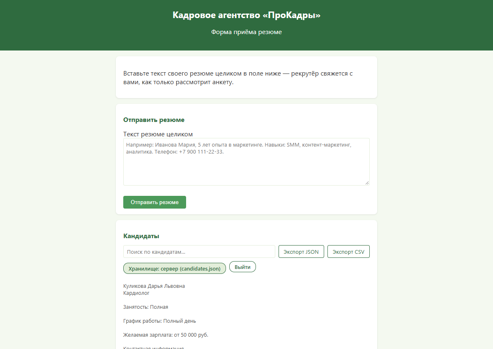

# «ПроКадры» — форма приёма резюме с AI-разбором

[](https://github.com/loparenok01-cpu/prokadry-resume-form/actions/workflows/ci.yml)
[](https://nodejs.org)
[](LICENSE)
[](#-тесты)

Веб-форма приёма резюме для кадрового агентства **«ПроКадры»**. Кандидат вставляет текст
резюме одним полем, система структурирует его в семь полей карточки (ФИО, желаемая должность,
зарплата, навыки, опыт, образование, контакты), а рекрутёр работает с базой кандидатов:
поиск, правка, удаление, экспорт в JSON/CSV.

Структурирование выполняется **GigaChat API** (ключ живёт только на сервере). Если ключа нет,
сервер недоступен или ИИ отвечает ошибкой — страница автоматически переключается на
**встроенную эвристику** (парсер на ключевых словах), поэтому форма работает всегда,
даже открытая файлом с диска, без сети и без бэкенда.

---



---

## Возможности

- **Приём резюме в одном поле** — кандидат вставляет текст целиком, никаких форм из 40 полей.
- **AI-разбор (GigaChat)** — `POST /api/extract` возвращает готовую JSON-карточку кандидата;
  промпт требует от модели ровно 7 полей и запрещает выдумывать отсутствующие данные.
- **Фолбэк на эвристику** — 79 автопроверок парсера: ФИО, телефоны (с защитой от ИНН и счетов),
  вилка зарплаты, «Цель резюме», многострочные блоки навыков, сокращение длинного опыта
  до 4 свежих мест + обобщение остальных.
- **База кандидатов** — `GET/POST/PUT/DELETE /api/candidates`, регистронезависимый поиск `?q=`,
  атомарная запись файла, экспорт JSON/CSV с защитой от CSV-инъекций (`=`, `+`, `-`, `@`).
- **Два режима хранения** — с сервером (`candidates.json`) или без него (`localStorage` браузера);
  бейдж в интерфейсе честно показывает, где сейчас данные.
- **Роли и доступ** — отправка резюме открыта всем (анонимный кандидат), чтение/правка/удаление
  базы требуют `Authorization: Bearer <APP_TOKEN>` (сравнение через `crypto.timingSafeEqual`).
- **Безопасность** — `helmet` (nosniff, DENY, Referrer-Policy, COOP/CORP, без `X-Powered-By`),
  строгий CSP, условный HSTS, rate limit 10 req/мин на тяжёлые ручки, лимиты ввода
  (текст ≤ 60 000 символов, JSON ≤ 600 КБ, `q` ≤ 200), слушаем только `127.0.0.1`.
- **Адаптивная вёрстка** — корректная работа на 375px (viewport + `@media`), без горизонтального скролла.
- **Презентация проекта** — самодостаточный HTML (инлайн-ресурсы) по адресу `/presentation`,
  открывается и по `file://` без сервера.
- **Демо-режим** — `npm run demo` поднимает сервер на вымышленной базе из коробки:
  без ключа GigaChat, без `.env`, реальная база не затрагивается.
- **CI** — GitHub Actions: `npm ci` → `node --check` → `npm test` на каждый push/PR.

## Стек

| Слой | Технологии |
|---|---|
| Backend | Node.js ≥ 18, Express 4, helmet, dotenv |
| Frontend | HTML + CSS + ванильный JavaScript (без фреймворков и сборки) |
| AI | GigaChat API (OAuth2 + chat completions), корневой сертификат НУЦ Минцифры |
| Эвристика | собственный парсер `public/js/heuristics.js` (общий для браузера и Node) |
| Тесты | Node-скрипты (107 проверок) + Playwright/Edge для UI-сценариев |
| Инфраструктура | GitHub Actions CI, опциональный нативный TLS / reverse-proxy |

## Как это работает

```
┌──────────────┐   GET /          ┌───────────────────────────┐
│   Браузер    │ ───────────────► │  Express (src/server.js)  │
│  index.html  │                  │  статика: public/*        │
└──────┬───────┘                  └─────────────┬─────────────┘
       │ POST /api/extract {text}               │
       │ ◄──────────────────────────────────────┤ rate limit 10/мин
       │                                        ▼
       │                             ┌──────────────────────┐  OAuth2 Bearer
       │                             │ GigaChat API         │◄──────────────┐
       │                             │ chat/completions     │               │
       │                             └──────────┬───────────┘      ключ только в .env
       │                                        │ JSON с 7 полями
       │ ◄──────────────────────────────────────┘
       │      (если ИИ недоступен → эвристика в браузере)
       ▼
  Карточка кандидата → POST /api/candidates → candidates.json (ПДн, в Git не попадает)
```

## Структура репозитория

```
prokadry-resume-form/
├── src/
│   ├── server.js              # Express: статика, GigaChat-клиент, CRUD, auth, rate limit
│   └── demo.js                # демо-режим: вымышленная база, токен demo-token
├── demo/
│   ├── candidates.demo.json   # демо-кандидаты (вымышленные, коммитятся в репозиторий)
│   └── candidates.local.json  # рабочая копия демо-базы (создаётся при npm run demo, в .gitignore)
├── public/                    # фронтенд (отдаётся сервером и работает по file://)
│   ├── index.html             # экран: форма + список кандидатов
│   ├── css/style.css          # стили, зелёная тема, адаптив от 375px
│   ├── js/script.js           # клиентская логика: отправка, хранилище, поиск, экспорт
│   ├── js/heuristics.js       # эвристика разбора резюме (браузер + require() в тестах)
│   └── presentation.html      # презентация проекта → /presentation
├── tests/
│   ├── heuristics.test.js     # 79 проверок парсера
│   ├── api.test.js            # 28 проверок API на изолированном сервере
│   ├── error502.test.js       # валидация ошибок (наружу уходит обобщённый ответ)
│   └── *.test.js              # UI-сценарии (roles, auth, csv, mobile, save-error)
├── docs/
│   ├── ЗАПУСК.md              # инструкция по запуску
│   ├── КОМАНДЫ_СЕРВЕР.md      # памятка по работе с сервером
│   ├── ПРОМЫШЛЕННАЯ.md        # прод-контур: TLS, reverse-proxy, чек-лист
│   ├── PROMPT_EXAMPLE.md      # пример промпта для GigaChat
│   ├── AUDIT_REPORT.md        # отчёт аудита релиз-кандидата (15/15 строк закрыто)
│   └── screenshots/           # скриншоты интерфейса и презентации
├── certs/                     # корневой сертификат НУЦ Минцифры для GigaChat
├── .github/workflows/ci.yml   # CI: npm ci → синтаксис → npm test
├── .env.example               # шаблон настроек (секреты — только в .env)
├── package.json
└── README.md
```

## Быстрый старт

**Требования:** Node.js ≥ 18.

### Вариант 1 — без сервера и ИИ

Откройте `public/index.html` двойным щелчком. Работает эвристика, данные сохраняются
в `localStorage` браузера.

### Вариант 2 — с сервером и GigaChat (основной)

```bash
git clone https://github.com/loparenok01-cpu/prokadry-resume-form.git
cd prokadry-resume-form
npm install
cp .env.example .env        # Windows: copy .env.example .env
# заполните .env: GIGACHAT_AUTH_KEY и APP_TOKEN
npm start                   # http://localhost:3000
```

Генерация токена рекрутёра:

```bash
node -e "console.log(require('crypto').randomBytes(24).toString('base64url'))"
```

Вход в базу кандидатов: кнопка **«Ввести токен»** рядом с бейджем хранилища
либо `http://localhost:3000/?token=ВАШ_ТОКЕН` (адрес сразу очищается от токена).

### Вариант 3 — демо (без ключа GigaChat и без `.env`)

```bash
npm run demo                 # http://localhost:3000/?token=demo-token
```

Сервер поднимается на вымышленной базе `demo/candidates.demo.json` — три кандидата
для показа интерфейса (список, поиск, правка, экспорт). Разбор резюме идёт встроенной
эвристикой, ваш реальный `candidates.json` не затрагивается: правки пишутся в
`demo/candidates.local.json` (в `.gitignore`, сбрасывается удалением файла).
Проверка демо:

```bash
node --check src/server.js && node --check public/js/script.js
npm test
curl http://localhost:3000/api/health     # {"ok":true,"ai":true,"model":"GigaChat-2-Pro",...}
```

Подробнее: [docs/ЗАПУСК.md](docs/ЗАПУСК.md) и [docs/КОМАНДЫ_СЕРВЕР.md](docs/КОМАНДЫ_СЕРВЕР.md).

## API

| Метод | Путь | Доступ | Описание |
|---|---|---|---|
| `POST` | `/api/extract` | публично, rate limit | разбор текста резюме → JSON с 7 полями (GigaChat) |
| `GET` | `/api/candidates?q=` | Bearer | список кандидатов, поиск без учёта регистра (`q` ≤ 200) |
| `POST` | `/api/candidates` | публично, rate limit | сохранить резюме (форма кандидата) |
| `PUT` | `/api/candidates/:id` | Bearer | обновить запись |
| `DELETE` | `/api/candidates/:id` | Bearer | удалить запись |
| `GET` | `/api/health` | публично | состояние: `ok`, `ai`, `model`, `cert`, `auth` |
| `GET` | `/` | публично | приложение |
| `GET` | `/presentation` | публично | презентация проекта |

Ответы об ошибках: `400` — невалидный ввод, `401` — нет/неверный токен,
`413` — текст длиннее 60 000, `429` — превышен лимит (есть `Retry-After`),
`502` — ИИ недоступен (тело обобщённое, детали только в логе сервера),
`503` — ключ не задан.

## Конфигурация (`.env`)

| Переменная | По умолчанию | Назначение |
|---|---|---|
| `GIGACHAT_AUTH_KEY` | — | ключ GigaChat (только сервер, в Git не попадает) |
| `GIGACHAT_SCOPE` | `GIGACHAT_API_PERS` | режим доступа |
| `GIGACHAT_MODEL` | `GigaChat-2-Pro` | модель |
| `GIGACHAT_CA_BUNDLE` | `certs/russian_trusted_root_ca_pem.crt` | корневой сертификат НУЦ |
| `APP_TOKEN` | — | токен рекрутёра для чтения/правки/удаления базы |
| `HOST` / `PORT` | `127.0.0.1` / `3000` | адрес и порт |
| `RATE_LIMIT_MAX` | `10` | запросов в минуту на тяжёлые ручки |
| `CANDIDATES_FILE` | `./candidates.json` | файл базы кандидатов |
| `TLS_CERT_FILE` / `TLS_KEY_FILE` | — | PEM-файлы для нативного HTTPS |

## Безопасность

- ключ GigaChat и токен рекрутёра **не попадают в браузер**: клиент видит только булевы
  значения `ai`/`auth` из `/api/health`;
- `.env`, `candidates.json`, `tokens.json`, `actions.log` — в `.gitignore`; в репозитории
  только плейсхолдеры `.env.example`;
- сравнение токена — `crypto.timingSafeEqual` (защита от timing-атак);
- статика отдаётся по белому списку файлов (path traversal исключён), 404-фолбэк;
- весь пользовательский текст выводится через `textContent`/`.value` (XSS не найден);
- `npm audit` — 0 уязвимостей;
- сервер по умолчанию слушает только `localhost`; на публичный контур — reverse-proxy + TLS
  ([docs/ПРОМЫШЛЕННАЯ.md](docs/ПРОМЫШЛЕННАЯ.md)).

Полный разбор — [docs/AUDIT_REPORT.md](docs/AUDIT_REPORT.md): 7 направлений аудита,
15/15 найденных проблем закрыто, есть «Положительные находки» и «Известные ограничения».

## Тесты

```bash
npm test              # эвристика (79) + API (28) = 107 проверок, прод-база не трогается
npm run test:api-extra  # контроль ошибок 502 (изолированный сервер)
npm run test:ui       # UI-сценарии: роли, авторизация, ошибка сохранения, CSV, мобильная вёрстка
                      # (нужен запущенный npm start и Microsoft Edge)
```

API-тесты поднимают собственный экземпляр сервера на отдельном порту с временной базой
(`tests/candidates-api-test.json`) — файл `candidates.json` проверяется хэшем до/после
прогона и не меняется.

CI (`.github/workflows/ci.yml`) на каждый push в `main`/`develop` и на каждый PR:
`npm ci` → `node --check` → `npm test`.

## История разработки

Проект собран итерациями, каждая — отдельный коммит:

| Итерация | Содержание |
|---|---|
| 1 | эвристический разбор резюме, настройка git |
| 2–3 | Express-сервер, интеграция GigaChat API (`.env`, фолбэк на эвристику) |
| 4 | хранилище кандидатов (CRUD, поиск, экспорт), зелёная тема, презентация, отчёт аудита |
| 5 | аутентификация и rate limit, мобильная вёрстка, доработка эвристики, документация |
| 6 | промышленный контур: helmet/CSP/HSTS, опциональный TLS, CI, модуль `heuristics.js` |
| 7 | публикация: структура репозитория `src/public/tests/docs`, README, MIT, зелёный CI |

### Ветки

| Ветка | Назначение |
|---|---|
| `main` | стабильная версия, сюда попадают релизы |
| `develop` | интеграционная ветка, рабочее состояние |
| `feature/*` | отдельные доработки, вливются в `develop` через PR |

## Документация

| Файл | О чём |
|---|---|
| [docs/ЗАПУСК.md](docs/ЗАПУСК.md) | запуск, настройка, хранение данных, проверка |
| [docs/КОМАНДЫ_СЕРВЕР.md](docs/КОМАНДЫ_СЕРВЕР.md) | команды запуска/остановки, логи, частые проблемы |
| [docs/ПРОМЫШЛЕННАЯ.md](docs/ПРОМЫШЛЕННАЯ.md) | прод-контур: TLS, reverse-proxy, чек-лист |
| [docs/PROMPT_EXAMPLE.md](docs/PROMPT_EXAMPLE.md) | промпт и формат ответа модели |
| [docs/AUDIT_REPORT.md](docs/AUDIT_REPORT.md) | отчёт аудита релиз-кандидата |
| [/presentation](https://github.com/loparenok01-cpu/prokadry-resume-form) | презентация проекта (после запуска: `http://localhost:3000/presentation`) |

## Ограничения

- персональные данные кандидатов хранятся в обычном JSON-файле — для реальной эксплуатации
  нужна БД, ротация, журналирование и юридическая оценка по 152-ФЗ (в объём аудита не входило);
- `localStorage`-режим — осознанный офлайн-фолбэк: данные видны только в этом браузере;
- нативный TLS опционален; прод-контур предполагает reverse-proxy (Caddy/nginx);
- нагрузочный тест и внешний пентест не выполнялись.

## Лицензия

[MIT](LICENSE)
